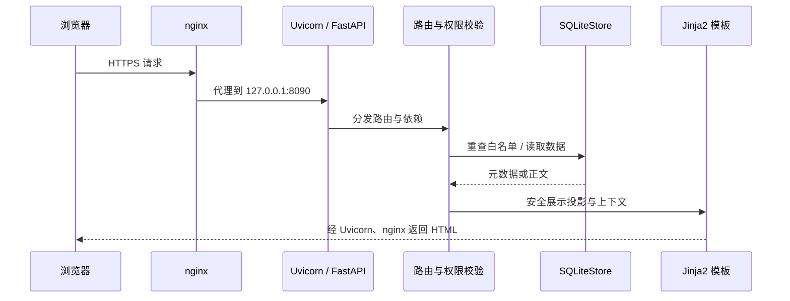
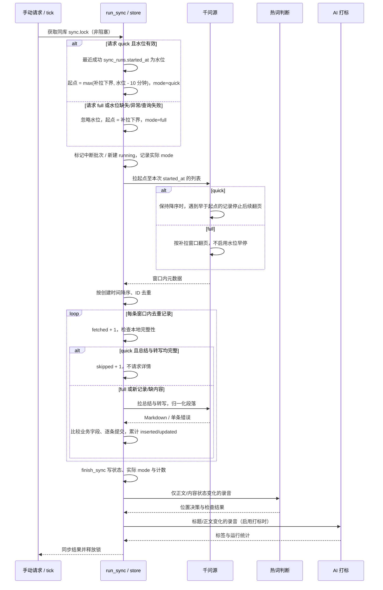

# 架构说明

系统是单机 FastAPI 应用：网页由 Jinja2 渲染，SQLite 保存原文与配置，systemd 执行设置驱动的定时工作。
不依赖 React 构建或独立数据库服务；业务行为、边界与接口契约见 [PRD](PRD.md)。

## 1. 模块职责

下表穷举 `app/*.py`，包含包入口和命令行模块；“被谁调用”列列出主要入口或调用方。

| 模块 | 职责 | 被谁调用 |
| --- | --- | --- |
| `__init__.py` | Python 包标记，无运行逻辑 | Python 导入机制 |
| `admin.py` | 管理员授权、CSRF/表单校验、白名单路由及子模块安装 | main |
| `apikeys.py` | API Key 创建/列表/撤销 CLI，明文仅创建时输出 | 管理员命令行 |
| `assistant.py` | 助手反馈、词表合并/停用、提案处理页面 | admin |
| `automation.py` | 自动化设置数据类、每日同步模式和每周全盘配置、默认值及表单校验 | store、settings_admin |
| `config.py` | 读取进程环境、校验身份配置与会话密钥 | main、admin、feishu、部署适配器 |
| `feishu.py` | OAuth 换身份、联系人搜索与安全错误封装 | main、admin、store |
| `home_presentation.py` | 列表日期分组、摘要展示数据 | main |
| `hotword_admin.py` | 标准词管理与上游预览/推送路由 | admin |
| `hotword_judge.py` | 提取上下文、调用模型、校验位置并持久化判断，支持补判 CLI | sync、命令行 |
| `hotword_migration.py` | 标准词结构迁移、位置决策及历史触发器 | store |
| `hotword_upstream.py` | 千问热词工具适配、配额快照、推送计划和结果记录 | hotword_admin（延迟导入）、store 迁移 |
| `hotwords.py` | 标准词/短片段校验、按决策替换及轨迹展示辅助 | store、hotword_judge、recording_edit、hotword_admin |
| `main.py` | 应用工厂、登录/阅读/同步/下载路由和模板上下文 | Uvicorn、部署适配器、测试 |
| `mcp.py` | 文件 OAuth 续期、锁与原子写回、MCP 重试、窗口列表早停与段落级容错 | main、sync、scheduler_tick、hotword_upstream |
| `minutes.py` | 录音数据结构、数据源协议、fixture 与兼容 HTTP MCP 客户端 | main、sync、mcp、展示/调度模块 |
| `model_admin.py` | 模型配置页面、增删启停、默认选择与连通性测试 | admin |
| `models.py` | 模型注册表、Fernet 加解密、公开投影和默认配置解析 | model_admin、tag、tag_maintenance、hotword_judge |
| `public_api.py` | 四类只读 API、Bearer 鉴权和调用审计 | main |
| `purge_fixture.py` | 只删除 fixture- 前缀录音的 CLI | 管理员命令行 |
| `rebuild_search.py` | 从原文重算 search_text 并重建 FTS5 的 CLI | 管理员命令行 |
| `recording_content.py` | 溯源清理、覆盖/热词投影、转写分段、Markdown 导出 | main、public_api、recording_edit、hotword_judge、store |
| `recording_edit.py` | 正文编辑/撤回、短词建议、逐处热词撤销路由 | admin、main |
| `scheduler_tick.py` | 读取设置、自判到期、领取日/周周期、保留期清理与任务执行 | systemd、settings_admin 计算下次时间 |
| `search.py` | 从命中原文生成搜索片段和高亮数据 | main |
| `session.py` | 有效期内签名 cookie 编解码 | main、admin 及管理页面 |
| `settings_admin.py` | 自动化设置页面、保存与下次运行展示 | admin |
| `store.py` | SQLite 迁移、查询、事务、文件锁及业务持久化 | 路由、同步、AI、调度与 CLI |
| `summary.py` | 安全 Markdown 渲染、只读待办和文档样式修饰 | recording_content、main |
| `sync.py` | quick/full 编排、水位与退化、跳过完整记录、批次计数及可选 AI 增强 | main、scheduler_tick、scripts/sync_once.py |
| `tag.py` | 模型打标、重试、并发/用量控制与 CLI | sync、tag_maintenance、models 的后备配置 |
| `tag_maintenance.py` | 词表归一、语义检查提案、维护运行记录与 CLI | scheduler_tick、命令行 |
| `tag_vocabulary.py` | 词表迁移、别名归一、事务合并及提案处理 | store、assistant、tag、tag_maintenance、tagging |
| `tagging.py` | 根据活动词表及反馈指令构建打标 system prompt | tag |

`app/templates/` 与 `app/static/` 分别保存 Jinja2 页面和原生 JS/CSS；静态文件由 FastAPI 挂载。
10-30 的同步模式改动未新增模块，职责分布在现有 sync、mcp、automation、scheduler_tick、store 及页面入口中。

## 2. 请求生命周期



nginx 终止 TLS 并设置 Host、转发协议与来源地址；Uvicorn 只监听本机。
应用工厂创建 store、数据源、签名器，lifespan 中迁移并种入管理员，管理员种子不会重新启用已停用用户。
网页路由在每次请求重新检查活动白名单；管理页面进一步核对管理员别名，表单校验 session 绑定的 CSRF。
详情先取同步原文，再投影人工覆盖及生效的热词，仅渲染当前视图；Markdown 禁用 HTML，模板转义其他文本。
下载跳过模板生成 Markdown；对外 API 使用独立鉴权中间件，并在 finally 中落审计，不走网页角色授权。

## 3. 同步管道时序

结论：先可靠保存原文，再做可失败的 AI 增强。产品逻辑可分为拉取 → 归一化 → 去重/幂等 → 入库 → 打标/热词判断。
**实际执行顺序是入库 → 记录同步结果 → 热词判断 → 打标**，以 `app/sync.py:run_sync` 为准。



- mcp 源读取 OAuth 文件，过期或被拒绝时在独立锁下续期并原子替换，分页/限流异常按客户端规则处理。
- 补拉下界为本次 started_at 减 backfill_days（默认 90 天）；quick 在此范围内使用最近成功批次 started_at 减 10 分钟，不再固定回退 2 天。无时区、未来时间等异常水位退化 full。
- mcp 通过 sync_range 按时间窗口取列表；quick 仅在截至当前页仍为降序时早停，检测到跨页/页内乱序则禁用早停。未见到的后续页若乱序，仍可能漏项，由全盘兜底。
- 兼容 HTTP/fixture 源逐日请求起点至今覆盖的日期，不能日内早停；所有源返回的元数据均再次按精确窗口过滤后才请求详情或入库。
- quick 对窗口内已有完整总结/转写的录音跳过详情，因此无新内容且无待补全记录时详情请求为 0；窗口以前的老记录不会被更新。full 忽略水位与完整性跳过规则，在补拉范围内逐条拉详情。
- 列表内重复 ID 只处理一次；相同业务字段不计更新，仅推进 synced_at；旧 owner_open_id 保留。
- 每条录音独立提交，详情或入库错误跳过该条并将批次标失败，列表错误停止后续拉取，不撤销已提交内容。
- 转写段落缺少/空 speakerName 使用「未标注发言人」；内容、时间或发言人类型无效只跳过该段，避免一段缺字段导致整条详情失败，结构损坏仍报错。
- 进程退出释放 flock；下一次获锁会把遗留 running 批次标 failed。锁文件不能在进程运行时删除或替换。
- 热词/打标异常只写安全日志，不能反向把成功同步改成失败；手动请求仍需等待这些可选步骤结束才返回。
- 热词读取原文的有限上下文，按字段及偏移记录决策；人工覆盖在展示时优先，不再套用自动校正。

## 4. 调度模型

`qwennote-tick.timer` 每 10 分钟唤醒一次，`app.scheduler_tick` 读取数据库 settings 自行判断是否到期。
固定 systemd 日时刻无法直接跟随网页设置变化；tick 使管理员保存配置后无需 root 改 unit 或重启 timer。
当前默认每日 03:00 快速同步（sync_mode_default=quick）、每周日 03:30 全盘同步、词表维护 05:00（上海时区）；每日同步也可改为 full 或整小时间隔，保留期清理默认关闭。
每周配置为 full_sync_enabled（默认 true）、full_sync_weekday（0=周一，默认 6=周日）、full_sync_time（默认 03:30），独立于每日 sync 开关。
`tag` 定时分支执行词表维护，不是全库重新打标；录音自动打标在同步后的增强阶段执行。

外层 scheduler.lock 防并发 tick，任务按 sync、full_sync、tag、retention 顺序尝试，独立失败不阻止后续任务；full_sync 强制使用 full 模式，与 sync 和手动同步共用 sync.lock。
执行外部操作前先提交 scheduler_state 的领取时刻，避免重启后重放副作用；普通失败/崩溃会消耗本周期。
同步锁冲突同样消耗本次槽位，不回退领取状态；每日/间隔任务等下一周期，每周全盘等下一周配置日，或人工触发同步。
full_sync 用上海时区周一为周起点比较 last_run_at：本自然周已领取则本周不再运行，失败、撞锁或改星期/时间均不例外，即每周最多一次；手动全盘不领取该调度槽位。
每日只补当天过时工作，不重放停机期间每一天；每周任务仅在配置星期到时后运行，错过整日等下一周。设置页的下次时间按 10 分钟边界取整，不承诺精确到分钟。
保留期清理持有同步锁与标签锁，以笔记创建时间删过期录音及人工覆盖，标签 FK 和 FTS 触发器随之清理。
旧 `qwennote-sync.timer` 和 `qwennote-tag-maintenance.timer` 留作历史配置，安装统一调度时禁用。

## 5. 存储与索引

完整表名、关键字段和关系见 [PRD 数据模型](PRD.md#6-数据模型)，以下按职责列出表清单。

| 类别 | 表 |
| --- | --- |
| 身份与同步 | users、recordings、sync_runs |
| 人工编辑 | recording_overrides（每字段最新一条，无版本历史） |
| 标签 | recording_tags、tag_runs、tags、tag_aliases、tag_merge_proposals、tag_semantic_checks、tag_change_log、assistant_config |
| 热词 | hotwords、recording_hotword_decisions、recording_hotword_checks、recording_hotword_decision_history、recording_hotword_check_history |
| 旧决策归档 | recording_hotword_legacy_decisions（仅旧结构升级时存在） |
| 上游推送 | hotword_upstream_sync、hotword_upstream_errors、hotword_upstream_runs、hotword_upstream_state |
| 配置与调度 | settings、scheduler_state、models |
| API | api_keys、api_audit |
| 搜索 | recordings_fts；SQLite 自动维护 recordings_fts_config/data/docsize/idx 影子表 |

SQLite 开启 WAL、连接启用 foreign_keys；结构迁移与历史字段回填由 migrate 幂等执行，不使用 ORM。
sync_runs.mode 保存实际执行模式 quick/full，快速请求退化时写 full；skipped 统计 quick 窗口内因总结与转写已完整而未拉详情的记录，不含窗口以前的记录。
fetched 是窗口内去重后检查数，inserted/updated 是实际入库变更数；mode 与 skipped 的旧行默认分别为 quick、0。水位查询只选成功批次的 started_at，失败批次不推进水位。
`recordings_created_at_idx(created_at DESC, recording_id DESC)` 对应稳定列表排序。
`models_one_default` 部分唯一索引只允许一个默认模型；录音 ID、标准词、标签名、Key 摘要及各组合主键负责幂等约束。
`hotword_decision_counts(hotword_id, revoked, recording_id)` 支持热词统计；决策/check 旧值由更新/删除触发器归档。

FTS5 使用 external-content 与 trigram tokenizer，以 recordings.rowid 对齐，search_text 由标题及清理后的原文组合。
插入、删除、search_text 变更触发器同步索引；首次迁移或显式 CLI 可 rebuild，不能手改影子表。
3 字以上查询整串加引号作为字面短语，1–2 字通过转义 LIKE 扫描；不提供语义搜索或任意 FTS 表达式。
人工覆盖和热词仅在读取时投影，不改变原文 search_text，因此新增编辑词尚不可检索。

## 6. 部署拓扑与回滚

```text
浏览器 → nginx（TLS）→ 127.0.0.1:8090 Uvicorn
                          └─ /opt/qwennote/current → releases/<UTC时间戳>/
                             ├─ .venv/ + .sqlite/ + app/ + scripts/
                             └─ /opt/qwennote/data/qwennote.db（跨版本共享）
/etc/qwennote/              环境文件与模型加密密钥
/etc/claude/                可选模型环境文件
/opt/qwennote/data/         SQLite、OAuth 文件及稳定锁文件
/opt/qwennote/backups/      最近七个日期的数据库快照
/opt/qwennote/previous      上一个有效 release 软链
```

prepare 建隔离虚拟环境及支持 FTS5 的 SQLite，不替换系统解释器；发布适配器只在 release 中生成 `app.main:app`。
activate 在部署锁下先保存 previous，再通过临时链接加 `mv -Tf` 切换 current，重启服务并检查本机首页返回 302。
本机检查失败时，有旧版则恢复旧链接，无旧版则停服务；TLS 检查失败会退出，但该阶段没有同样的自动回链保证。
`rollback.sh` 切 previous、重启与检查；失败恢复原 current，成功后交换 previous 便于再次切换。
代码回滚不恢复数据库、不回退迁移、不撤销千问热词；迁移不兼容时应先停写并按备份恢复计划处理。
首次部署、跨环境域名替换、备份及手动回滚命令见 [运维手册](OPERATIONS.md)。
